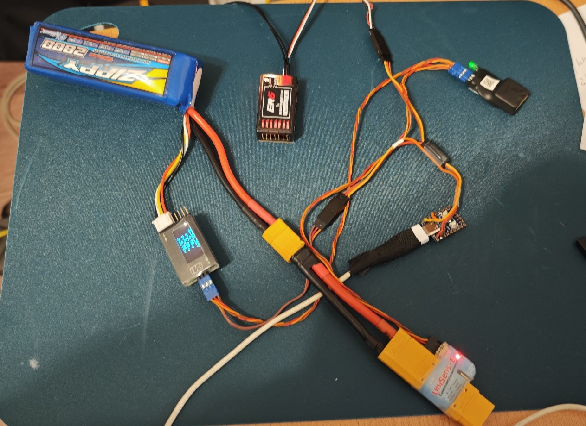

# FRSKY S.Port to HOTT, Multiplex, Jeti Exbus Converter (RP2040)

**Dokumentation:** [Aufbau](Doku/Aufbau.md) | [USB-Menü](Doku/Konverter.md) | [Eingangswerte FRSKY](Doku/FRSKY.md) | [Ausgangswerte oXs](Doku/Fields-per-Protocol.md) | [openXsensor Basis](https://github.com/Networker-001/oXs_on_RP2040-add-ons) | **[RC-Network Diskussion](https://www.rc-network.de/threads/telemetrie-wandler-frsky-s-port-nach-hott-crsf.12146885/#post-13374304)**

Die hier vorgestellte Lösung ermöglicht die Übertragung von Telemetriewerten von FrSky S.Port Sensoren zu Multiplex, Jeti REX, ELRS (CRSF), HoTT und weiteren Empfängern. Benötigt wird lediglich ein kleines **Waveshare RP2040-Zero** Board, das mit einem Widerstand zwischen Sensor und Empfänger geschaltet wird.

**Schnellstart:** RP2040 per USB mit dem PC verbinden, die passende `.uf2`-Datei aus dem Ordner [Config](./Config) auf das Laufwerk kopieren – fertig.

---

### Praxisbeispiel: 3 FrSky Sensoren am ELRS-Empfänger (S.Port nach CRSF)

